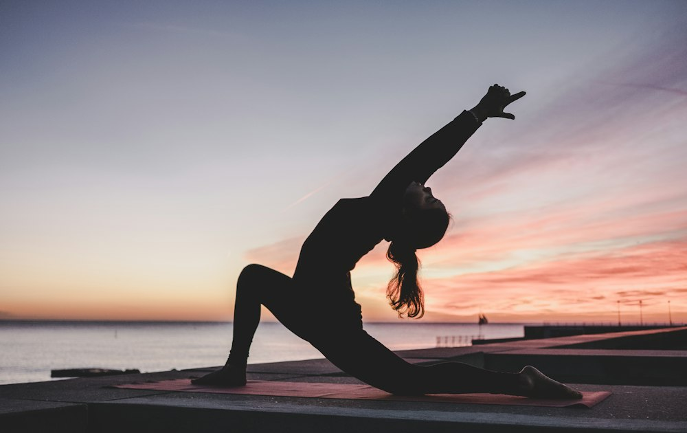

# Changing the Website Photos

The website currently uses **placeholder stock photos** from Unsplash. This guide lists every photo, where it appears, and how to replace it with real photos of Empower Her.

All photos live in one folder: **`assets/img/`**

---

## The easy way: replace a file with the same name

You don't need to edit any code for most photos.

1. Choose your new photo.
2. Rename it to **exactly** the same name as the photo you are replacing (for example `lake.jpg`).
3. Put it in `assets/img/`, overwriting the old file.
4. Refresh the website. The new photo now appears everywhere the old one was used.

> **Tip:** Some photos are used on more than one page (see the table). Replacing the file changes it in all of those places.

---

## Photo checklist (before you upload)

- **Format:** `.jpg`
- **Size:** about **1600–2000 px wide** for large banner photos, **1000–1200 px wide** for the rest.
- **File size:** under **500 KB** if possible so the site loads quickly on mobile data. Free tool: [squoosh.app](https://squoosh.app) (choose MozJPEG, quality ~75).
- **Shape:** match the shape listed in the table below so nothing important gets cropped off.
- **Consent and privacy:** only use photos of clients, staff or visitors with their **written permission**. For clients, a face that can be recognised can reveal that someone was in treatment. When in doubt, use photos taken from behind, in silhouette, of hands, or of nature and the centre's grounds.

---

## Where every photo appears

| File in `assets/img/` | Page(s) | Where on the page | Best shape | What it shows now | Ideas for a real photo |
|---|---|---|---|---|---|
| `hero.jpg` | Home | Big banner at the very top, behind "Healing. Hope. Empowerment." Also the preview image when the site link is shared on WhatsApp, Facebook etc. | Landscape or tall. **Keep the person or main subject on the right half**; the left side sits behind the text. | Woman with eyes closed, face lifted | A peaceful moment at the centre, a woman in the garden |
| `sisterhood.jpg` | Home, Stories | Home: next to "A sanctuary created by women, for women". Stories: dark background behind the "Every story of recovery…" quote | Landscape | Group of women hugging at sunrise | A group from behind, a community event |
| `woman-sea.jpg` | Home | Dark background behind the quote "Healing begins when women feel safe…" | Wide landscape (text sits on top, photo is darkened) | Woman silhouetted by the sea | Sunrise or sunset over the grounds |
| `woman-smile.jpg` | About Us | Next to "Filling a deep gap in women's recovery care" | Portrait, about 4:5 | Smiling woman | Staff member or a warm moment at the centre |
| `meditation.jpg` | About Us | Next to "Recovery is not one-size-fits-all" | Portrait, about 4:5 | Woman meditating | A yoga or mindfulness session |
| `yoga-sunset.jpg` | Programs | "Residential Treatment" section | Landscape or square | Woman doing yoga at sunset | Fitness, art or group therapy room |
| `forest.jpg` | Programs | "Aftercare & Relapse Prevention" section | Landscape or square | Sunlit forest path | Path or garden at the centre |
| `holding-hands.jpg` | Programs | "Family Therapy & Education" section | Landscape or square | Two people holding hands | Family session (with consent), hands only |
| `sunrise.jpg` | Programs, Get Involved | Programs: "Outreach & Community Programs" section. Get Involved: dark background behind the "Because every woman deserves a second chance" quote | Wide landscape | Sunrise over a misty field | Community talk or outreach event |
| `lake.jpg` | Admissions | Next to "A calm, homely place to heal" | Landscape, about 4:3 | Calm lake and mountains | Bedrooms, lounge or the centre's exterior |
| `mindfulness.jpg` | Resources | Card: "Women's mental health & addiction recovery" | Landscape, about 16:10 | A card reading "mindfulness" | Books or a journal |
| `hands-calm.jpg` | Resources | Card: "Self-care & mindfulness tips" | Landscape, about 16:10 | Hands in a meditation pose | Tea, journaling, a quiet corner |
| `woman-profile.jpg` | Resources | Card: "Stories from women in recovery" | Landscape, about 16:10 | Woman in profile | A silhouette or a woman from behind |
| `flowers.jpg` | Resources | Card: "National Recovery Month highlights" | Landscape, about 16:10 | Bright flowers in a field | Photo from a Recovery Month event |
| `yoga-beach.jpg` | Resources | Card: "Downloadable wellness resources" | Landscape, about 16:10 | Women doing yoga on a beach | A wellness session |
| `woman-confident.jpg` | Resources | Card: "Supporting a loved one" | Landscape, about 16:10 | Confident smiling woman | Family members together (with consent) |
| `woman-portrait.jpg` | Stories | Next to "One day at a time" | Portrait, about 4:5 | Portrait of a woman | A graduate or milestone celebration (with consent) |

The **Contact**, **Get Involved** (except the quote background) and inner-page headers use soft colour backgrounds, not photos.

---

## Changing the description of a photo (alt text)

Each photo has a short description for blind visitors who use screen readers, and for Google. If your new photo shows something different, update its description:

1. Open the page file (for example `programs.html`) in a text editor such as Notepad or VS Code.
2. Search for the file name, e.g. `yoga-sunset.jpg`.
3. Change the text inside `alt="…"`, for example:

```html

```

Background photos behind quotes have `alt=""` on purpose (they are decoration). Leave those empty.

---

## Photos that need a small code change

These spots currently show **initials or icons instead of photos**. To add a real photo, first put the photo in `assets/img/`, then edit the HTML as shown.

### 1. Wangui Mucara: founder portrait (About Us page)

Shape: **portrait, 4:5** (e.g. 800 × 1000 px). Save as `assets/img/wangui-mucara.jpg`.

In `about.html`, search for `founder-portrait` and replace this block:

```html
<div class="founder-portrait" role="img" aria-label="Portrait placeholder for Wangui Mucara">
  <span class="initials">WM</span>
  <small>Photo coming soon</small>
</div>
```

with:

```html
<div class="founder-portrait">
  
</div>
```

### 2. Team circles (About Us page, "Our team" section)

Shape: **square** (e.g. 400 × 400 px), face centred; it will be shown as a circle.

In `about.html`, search for `class="avatar` and replace the initials or icon inside with an image. For example, Wangui's team circle:

```html
<div class="avatar">WM</div>
```

becomes:

```html
<div class="avatar"></div>
```

and Pastor Steve's:

```html
<div class="avatar sage">PS</div>
```

becomes:

```html
<div class="avatar sage"></div>
```

The "Counsellors & Therapists" and "Medical & Nursing" circles show icons (a long `<svg>…</svg>` line). Replace the whole `<svg>…</svg>` with an `` tag in the same way if you want a group photo there.

---

## After changing photos

1. Open the site and check each page on a **computer and a phone**: is anything important (faces, heads) cut off?
2. If a photo is cropped badly, choose a photo closer to the "Best shape" in the table, or crop it yourself before uploading.
3. Save your changes to GitHub (upload the files on github.com, or commit and push). If the site is hosted on Netlify, Cloudflare Pages or GitHub Pages, it updates automatically within a few minutes.

## Photo credits

The current placeholder photos are from [Unsplash](https://unsplash.com) and are free to use under the [Unsplash License](https://unsplash.com/license). No credit is required, but they should be replaced with real photos of Empower Her before launch.
